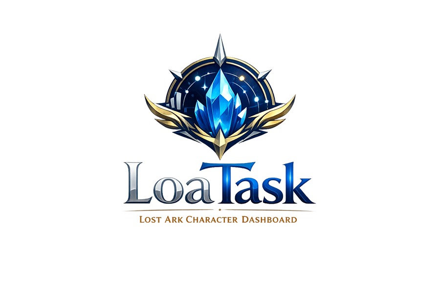

<p align="center">
  
</p>

# LoaTask

로스트아크 캐릭터 정보를 검색할 수 있는 웹 서비스입니다.

캐릭터명을 입력하면 Lost Ark Open API에서 기본 프로필을 조회해 화면에 보여줍니다. 캐릭터별 누적 검색 횟수와 TOP 10 순위 조회와 브라우저 즐겨찾기 저장을 구현했습니다. 커뮤니티 게시판과 챗봇 등을 차례로 추가할 예정입니다.

## 프로젝트의 목표

- Spring Boot 기반 REST API 개발
- MySQL과 JPA를 활용한 데이터 저장
- Lost Ark Open API 연동
- 외부 API 응답 DTO 매핑
- Vue.js와 Vuetify, Chart.js 등 라이브러리를 활용한 화면 UI 구현
- 캐릭터 검색 서비스 구조 설계
- 검색 순위, 커뮤니티, 챗봇 기능 등 확장 예정

## 기술 스택

### Backend

- Java
- Spring Boot
- Spring Web
- Spring Data JPA
- MySQL
- Lombok
- RestClient

### Frontend

- Vue 3
- TypeScript
- Axios
- Pinia
- Vue Router
- Vuetify

### Tools

- IntelliJ IDEA
- VSCode
- MySQL Workbench
- Git / GitHub
- Lost Ark Open API
- OpenAI API

## 홈 화면

첫 접속 시 공식 공지·진행 중인 이벤트·즐겨찾기·누적 검색 TOP 5·운세 바로가기를 표시합니다. 성공한 최근 검색은 이 브라우저에 5개까지 보관하며 기존 검색 주소를 유지합니다. [구현과 검증 범위](docs/home-page.md)를 참고하세요.

## 주요 기능

### 구현 완료

- 로스트아크 프로젝트 상태 확인 API
- 캐릭터 등록 API
- 캐릭터 목록 조회 API
- 캐릭터 상세 조회 API
- 캐릭터 수정 API
- 캐릭터 삭제 API
- 로스트아크 공식 API 캐릭터 프로필 조회
- 공식 API로 조회한 캐릭터 정보를 DB에 저장하는 기능
- Vue.js 프로젝트 구성
- Vuetify 기반 메인 화면 구성
- 캐릭터 검색 API 프론트 연동
- 캐릭터명 검색 화면과 검색 결과 카드
- 서버, 직업, 이미지, 아이템 레벨, 원정대·캐릭터 레벨, 길드, 영지 정보 표시
- 캐릭터 상세정보: 전투 특성·성향·전투력, 장비·장신구 품질/옵션, 각인, 보석, 카드/세트 효과, 스킬/트라이포드/룬, 아크 패시브
- 원정대 캐릭터 목록: 서버 선택, 아이템 레벨순 정렬, 현재 캐릭터 표시, 다른 캐릭터 상세 이동
- 검색 주소로 접속하거나 새로고침할 때 자동 조회
- 없는 캐릭터, 공식 API 오류·요청 제한, 연결 실패·시간 초과 안내
- 상세 화면 로딩 표시, 조회 실패 안내와 재시도
- 캐릭터별 누적 검색 횟수 저장·집계
- 누적 검색 순위 TOP 10 API와 화면 연동
- 검색 결과·상세 화면에서 즐겨찾기 추가·해제
- 브라우저에 즐겨찾기 저장 및 목록에서 다시 검색

- 욤의 오늘의 운세: 창작 카드 36장·주제별 해석 108개, 항목별 하루 2회 추첨과 씨앗 그림

### 구현 중

- 캐릭터 검색 기능의 예외 상황 검증과 사용성 개선

화면의 '누적 검색 순위'는 **전체 누적 검색 횟수 기준**입니다. 검색과 화면 진입 시 순위를 조회하며, 주기적 자동 갱신이나 일별·시간별 집계는 구현하지 않았습니다. 상세 화면 조회와 검색 주소 새로고침도 현재 검색 횟수에 포함됩니다.

### 구현 예정

- 운세에 고민을 입력하면 AI가 카드와 연결해 해석하는 기능

- 커뮤니티 게시판
- 게시글 작성, 조회, 수정, 삭제
- 캐릭터 정보 기반 챗봇
- 주간 숙제 체크 기능
- 원정대 대시보드의 숙제·성장 집계(캐릭터 목록은 구현 완료)

즐겨찾기는 로그인 없이 현재 브라우저의 `localStorage`에 캐릭터명만 저장합니다. 다른 기기나 브라우저와 동기화되지 않으며, 브라우저 데이터를 삭제하면 사라집니다. 즐겨찾기 추가·해제는 서버를 호출하지 않습니다. 목록에서 검색하면 일반 검색처럼 검색 횟수가 증가합니다.

## 로컬 실행과 검증

### 준비

- Java 17
- Node.js: `package.json`의 요구 버전(`^22.18.0 || >=24.12.0`)에 맞는 버전
- 개발용 MySQL과 필요한 테이블
- Lost Ark Open API 키

### 백엔드

저장소 루트에서 실행합니다. 아래 명령은 DB 스키마를 자동 변경하지 않으므로, 필요한 테이블은 미리 준비되어 있어야 합니다.

```sh
./gradlew bootRun --args='--spring.jpa.hibernate.ddl-auto=none'
```

- 서버: `http://localhost:8080`
- 상태 확인: `http://localhost:8080/api/lostark/status`

### 프론트엔드

별도 터미널에서 실행합니다.

```sh
cd frontend
npm ci
npm run dev
```

기본 주소는 `http://localhost:5173`입니다. 프론트엔드는 `http://localhost:8080`의 백엔드를 호출합니다. 실제 캐릭터 검색과 상세 조회는 개발용 DB의 검색 횟수를 증가시킵니다.

### 빌드·테스트

```sh
# 저장소 루트: 백엔드 빌드 및 테스트
./gradlew clean build

# 프론트엔드: 타입 검사 및 빌드
cd frontend
npm run build
node --test tests/favoriteStore.test.mjs
```

백엔드 애플리케이션 테스트는 H2 메모리 DB를 사용합니다. 프로필 응답 변환·오류 처리 테스트는 가짜 공식 API 응답으로 검증하므로 실제 DB와 외부 API에 접근하지 않습니다.

검색 화면과 상세 화면에서 없는 캐릭터 안내, 백엔드 중지 시 연결 실패 안내, 상세 조회 실패 후 '다시 시도'를 확인할 수 있습니다. 검색 결과의 **상세 보기**로 이동하면 장비·장신구, 각인, 보석, 카드, 전투 특성, 스킬과 아크 패시브를 확인할 수 있습니다. 장비·보석·스킬은 누르면 설명이 펼쳐집니다. 장착하지 않은 항목은 빈 상태로 안내하며, 공식 설명은 HTML을 실행하지 않고 텍스트로만 표시합니다. 상세 API `GET /api/lostark/official/characters/{characterName}/armory`는 공식 통합 API의 필요한 항목을 한 번에 조회하며, 성공 시 검색 횟수도 한 번만 증가합니다. 자체 딜 계산·순위 산정·아크 그리드·원정대 캐릭터 목록은 이번 상세정보에 포함하지 않습니다.

## 원정대 캐릭터 목록

검색 결과의 **상세 보기**로 이동하면 원정대 캐릭터 목록을 볼 수 있습니다. [구현 구조와 확인 방법](docs/character-roster.md)에 API·캐시·서버 선택·검증 범위를 정리했습니다.

## 외부 API 호출 최적화

캐릭터 응답을 서버 메모리에 저장해 같은 조회의 공식 API 호출을 줄입니다. [캐시 정책과 비교 측정](docs/character-cache.md)을 참고하세요. 요청·적중률·외부 지연·오류는 1분마다 서버 로그에 기록하며, [운영 지표 확인 방법](docs/character-api-metrics.md)에 항목과 비교 절차를 정리했습니다.

## 욤의 오늘의 운세

`http://localhost:5173/fortune`에서 사용할 수 있습니다. 오늘의 모험, 레이드 전 한 장, 이번 주 원정대 중 주제를 선택하고 카드 한 장을 뽑습니다. 브라우저에서만 동작하므로 백엔드나 API 키 없이 확인할 수 있습니다.

36장의 창작 카드를 섞어 세 장을 보여주며, 세 항목마다 36개씩 총 108개 해석을 제공합니다. 오늘의 모험·레이드 전 한 장·이번 주 원정대는 각각 한국 시간 기준 하루 2회(최초 1회 + 다시 뽑기 1회)까지 이용할 수 있습니다. Pinia와 localStorage에 횟수·마지막 결과를 저장해 새로고침이나 항목 이동으로 초기화되지 않습니다. 두 번째 추첨에서는 첫 번째 카드를 제외합니다. 씨앗·새싹과 모험 소품을 직접 그린 SVG 일러스트를 사용합니다. 실제 게임 확률을 예측하지 않습니다. 고민 입력란은 준비 중으로 비활성화되어 있고 AI 호출·고민 저장·전송은 구현하지 않았습니다.

[구현 및 일일 제한 설명](docs/fortune-daily-limit.md)을 참고하세요. 제한은 이 브라우저에 적용되며 다른 기기나 저장 데이터 삭제까지 막는 계정 단위 제한은 아닙니다.

운세 데이터와 셔플 검증: `cd frontend` 후 `node --test tests/fortune.test.mjs`

## 프론트엔드 무료 배포 (Vercel)

GitHub의 `loatask` 저장소를 Import하고 아래 값을 사용합니다.

| 항목 | 값 |
| --- | --- |
| Root Directory | `frontend` |
| Framework Preset | Vite |
| Build Command | `npm run build` |
| Output Directory | `dist` |
| Install Command | `npm ci` |
| Node.js Version | 24.x |

`frontend/vercel.json`의 rewrite는 `/fortune`이나 `/character/이름`으로 직접 접속하거나 새로고침해도 Vue 화면을 제공하도록 합니다.

백엔드 배포 전에는 환경변수를 비워 둡니다. 운세와 화면은 사용할 수 있고, 캐릭터 조회는 서버 연결 준비 중으로 안내합니다. 배포된 화면에서 방문자의 localhost로 API를 호출하지 않습니다.

백엔드 배포 후 Vercel 환경변수 `VITE_API_BASE_URL`에 `https://백엔드주소/api/lostark`를 설정하고 다시 배포합니다. `VITE_` 변수는 브라우저에 공개되므로 API 키나 DB 비밀번호를 넣지 않습니다. 로컬 개발에서는 변수가 없으면 기존 `http://localhost:8080/api/lostark`를 사용합니다.

## 백엔드 무료 배포 준비 (Aiven MySQL + Render)

기존 로컬 DB를 복사하지 않고 **새 Aiven Free MySQL**을 만듭니다. 무료 플랜은 클라우드와 지역을 직접 선택할 수 없습니다. 서비스가 Running이 되면 Overview/Quick connect에서 연결 정보를 확인하고 CA 인증서를 다운로드합니다. 접속 URI에 포함된 비밀번호를 Git이나 채팅에 공유하지 않습니다.

Render의 New → Web Service에서 GitHub 저장소 `Cheol-Jin/loatask`를 선택합니다.

| 항목 | 값 |
| --- | --- |
| Language / Runtime | Docker |
| Branch | main |
| Root Directory | 비워 둠 (저장소 루트) |
| Dockerfile Path | `./Dockerfile` |
| Instance Type | Free |
| Health Check Path | `/api/lostark/status` |

Render 환경변수는 다음과 같이 설정합니다. 아래 URL의 HOST·PORT는 Aiven 값으로 바꿉니다.

| 변수 | 값 |
| --- | --- |
| DB_JDBC_URL | `jdbc:mysql://HOST:PORT/defaultdb?sslMode=VERIFY_IDENTITY&serverTimezone=UTC` |
| DB_USERNAME | Aiven 사용자명 |
| DB_PASSWORD | Aiven 비밀번호 |
| LOSTARK_API_KEY | 로스트아크 공식 API 키 (Bearer 접두사 없이 키만) |
| FRONTEND_ORIGIN | `https://loatask.vercel.app` |

Render의 Secret Files에 `aiven-ca.pem`이라는 이름으로 Aiven CA 인증서 전체 내용을 등록합니다. 컨테이너는 Java 기본 공인 인증서 저장소를 임시 truststore로 복사한 뒤 Aiven CA를 추가합니다. 따라서 MySQL 서버 인증서와 로스트아크 API의 공인 HTTPS 인증서를 모두 검증할 수 있습니다. 인증서 파일이 없으면 시작을 중단합니다. 인증서·비밀번호·API 키는 Docker 이미지에 포함하지 않습니다.

Docker는 테스트를 포함한 Gradle build를 실행하고 Java 17에서 앱을 시작합니다. 실행 시 prod 프로필이 선택되며 Render의 PORT를 사용합니다. 로컬 application.properties는 빌드에 복사하지 않습니다. prod 설정은 연결된 DB에 두 테이블을 없을 때만 생성한 후 Hibernate로 구조를 검증합니다. 기존 테이블을 수정하거나 데이터를 삭제하지 않으므로 **새 배포용 DB**에 연결하세요. 향후 테이블 변경은 별도 마이그레이션을 준비해야 합니다.

prod에서는 인증이 없는 캐릭터 등록·수정·삭제·import API를 차단하고 조회만 허용합니다. 공식 프로필 조회에 따른 검색 횟수 집계는 계속 저장됩니다. Redis는 현재 기능에서 사용하지 않아 별도 서버가 필요하지 않습니다.

Render가 Live가 되면 `/api/lostark/status`와 `/api/lostark/search/rankings`를 확인합니다. Vercel의 VITE_API_BASE_URL을 `https://실제-Render-주소/api/lostark`로 설정하고 새 배포를 실행합니다. Free 서버가 쉬고 있으면 첫 요청에 약 1분 걸릴 수 있어 배포 화면의 API 대기 시간을 90초로 설정했습니다.

로컬 검증의 prod 테스트는 H2 메모리 DB를 사용해 초기 스키마, 검색 집계, CORS, 관리 API 차단을 확인합니다. 실제 Aiven/MySQL 연결, 컨테이너 실행, 512MB 내 메모리 사용은 Render 배포에서 추가 확인해야 합니다.

로컬 `application.properties`는 Git 추적에서 제외했습니다. 과거 커밋에 비밀 값이 들어갔다면 기록에서 사라지는 것은 아니므로, 로스트아크 API 키를 교체하고 배포에는 새 키를 사용하세요. 로컬 파일은 유지됩니다.
