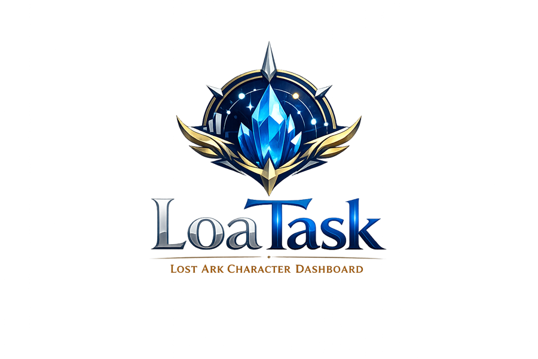

<p align="center">
  
</p>

# LoaTask

로스트아크 캐릭터 정보를 검색할 수 있는 웹 서비스입니다.

캐릭터명을 입력하면 Lost Ark Open API에서 기본 프로필을 조회해 화면에 보여줍니다. 캐릭터별 누적 검색 횟수와 TOP 10 순위 조회까지 구현되어 있으며, 즐겨찾기, 커뮤니티 게시판, 챗봇 등을 차례로 추가할 예정입니다.

## 프로젝트의 목표

- Spring Boot 기반 REST API 개발
- MySQL과 JPA를 활용한 데이터 저장
- Lost Ark Open API 연동
- 외부 API 응답 DTO 매핑
- Vue.js와 Vuetify, Chart.js 등 라이브러리를 활용한 화면 UI 구현
- 캐릭터 검색 서비스 구조 설계
- 검색 순위, 커뮤니티, 챗봇 기능 등 확장 예정

## 기술 스택

### Backend

- Java
- Spring Boot
- Spring Web
- Spring Data JPA
- MySQL
- Lombok
- RestClient

### Frontend

- Vue 3
- TypeScript
- Axios
- Pinia
- Vue Router
- Vuetify

### Tools

- IntelliJ IDEA
- VSCode
- MySQL Workbench
- Git / GitHub
- Lost Ark Open API
- OpenAI API

## 주요 기능

### 구현 완료

- 로스트아크 프로젝트 상태 확인 API
- 캐릭터 등록 API
- 캐릭터 목록 조회 API
- 캐릭터 상세 조회 API
- 캐릭터 수정 API
- 캐릭터 삭제 API
- 로스트아크 공식 API 캐릭터 프로필 조회
- 공식 API로 조회한 캐릭터 정보를 DB에 저장하는 기능
- Vue.js 프로젝트 구성
- Vuetify 기반 메인 화면 구성
- 캐릭터 검색 API 프론트 연동
- 캐릭터명 검색 화면과 검색 결과 카드
- 서버, 직업, 이미지, 아이템 레벨, 원정대·캐릭터 레벨, 길드, 영지 정보 표시
- 캐릭터 기본 프로필 상세 화면
- 검색 주소로 접속하거나 새로고침할 때 자동 조회
- 없는 캐릭터, 공식 API 오류·요청 제한, 연결 실패·시간 초과 안내
- 상세 화면 로딩 표시, 조회 실패 안내와 재시도
- 캐릭터별 누적 검색 횟수 저장·집계
- 누적 검색 순위 TOP 10 API와 화면 연동

### 구현 중

- 캐릭터 검색 기능의 예외 상황 검증과 사용성 개선

화면의 '실시간 검색 순위'는 현재 **전체 누적 검색 횟수 기준**입니다. 검색과 화면 진입 시 순위를 조회하며, 주기적 자동 갱신이나 일별·시간별 집계는 구현하지 않았습니다. 상세 화면 조회와 검색 주소 새로고침도 현재 검색 횟수에 포함됩니다.

### 구현 예정

- 검색한 캐릭터 즐겨찾기 저장
- 커뮤니티 게시판
- 게시글 작성, 조회, 수정, 삭제
- 캐릭터 정보 기반 챗봇
- 주간 숙제 체크 기능
- 원정대 대시보드

## 로컬 실행과 검증

### 준비

- Java 17
- Node.js: `package.json`의 요구 버전(`^22.18.0 || >=24.12.0`)에 맞는 버전
- 개발용 MySQL과 필요한 테이블
- Lost Ark Open API 키

백엔드 설정은 `src/main/resources/application.properties`에서 확인합니다. DB 연결 대상은 개발용 로컬 DB로 지정하고, 비밀번호와 API 키는 Git에 올리지 마세요. `SPRING_DATASOURCE_URL`, `SPRING_DATASOURCE_USERNAME`, `SPRING_DATASOURCE_PASSWORD`, `LOSTARK_API_KEY` 환경변수로 설정을 덮어쓸 수 있습니다.

### 백엔드

저장소 루트에서 실행합니다. 아래 명령은 DB 스키마를 자동 변경하지 않으므로, 필요한 테이블은 미리 준비되어 있어야 합니다.

```sh
./gradlew bootRun --args='--spring.jpa.hibernate.ddl-auto=none'
```

- 서버: `http://localhost:8080`
- 상태 확인: `http://localhost:8080/api/lostark/status`

### 프론트엔드

별도 터미널에서 실행합니다.

```sh
cd frontend
npm ci
npm run dev
```

기본 주소는 `http://localhost:5173`입니다. 프론트엔드는 `http://localhost:8080`의 백엔드를 호출합니다. 실제 캐릭터 검색과 상세 조회는 개발용 DB의 검색 횟수를 증가시킵니다.

### 빌드·테스트

```sh
# 저장소 루트: 백엔드 빌드 및 테스트
./gradlew clean build

# 프론트엔드: 타입 검사 및 빌드
cd frontend
npm run build
```

백엔드 애플리케이션 테스트는 H2 메모리 DB를 사용합니다. 프로필 응답 변환·오류 처리 테스트는 가짜 공식 API 응답으로 검증하므로 실제 DB와 외부 API에 접근하지 않습니다.

검색 화면과 상세 화면에서 없는 캐릭터 안내, 백엔드 중지 시 연결 실패 안내, 상세 조회 실패 후 '다시 시도'를 확인할 수 있습니다. 장비·각인·보석 등 확장 상세정보는 아직 구현되어 있지 않습니다.
